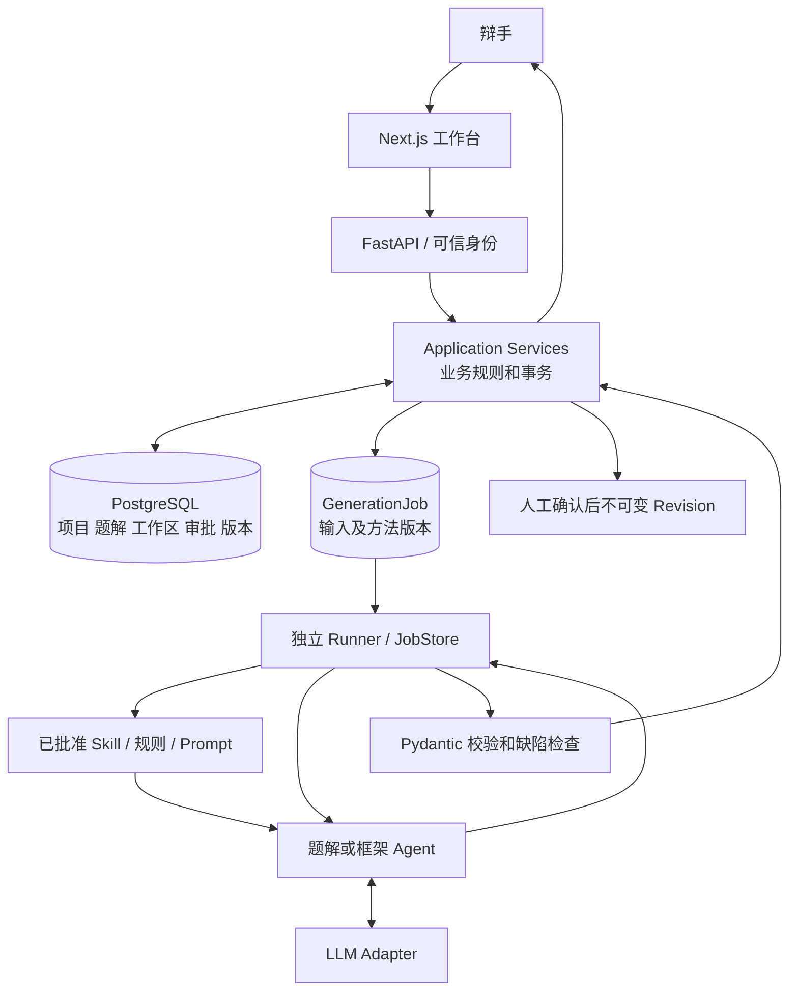

# 架构设计与模块契约

**状态：** MVP 设计基线，待双方用真实、已授权样本评审。本文是当前架构、数据/API、Agent 与 Skill 交付边界的**唯一现行说明**；字段及类型以 [`backend/app/schemas/`](../backend/app/schemas/) 的代码为当前可执行事实。文中“待实现/待新增”均不是已交付功能。

## 1. 架构和选型

采用**模块化单体 + PostgreSQL 持久化任务 + 独立 Python Runner**。前端目标为 Next.js/TypeScript；后端 FastAPI + Pydantic v2；持久化使用 PostgreSQL 16、SQLAlchemy 2 与 Alembic。API 进程和 Runner 可以分别运行同一代码库；Agent 通过可替换 LLM Adapter 调用同一个或不同底层模型，题解与框架是**两个逻辑 Agent**。Skill/Prompt 是版本化方法资产，不是能写数据库的第三个 Agent。



选型理由：Python/Pydantic 与现有契约和模型调用相符；PostgreSQL 同时支持关系事务、论证树 JSONB 快照和 `FOR UPDATE SKIP LOCKED` 任务领取。预计初期并发低，**不先引入**微服务、Redis、消息队列、向量数据库、LangGraph、微调或 Kubernetes；若实际出现任务排队、并行子流程或相似样本检索需求，再通过指标评估。SQLite 烟测不能替代 PostgreSQL 并发验证。外部模型调用始终在数据库事务外。

## 2. 唯一写入边界（模块契约）

| 模块 / Owner | 输入 -> 输出 | 允许及禁止 |
| --- | --- | --- |
| API + 身份适配 / 系统负责人 | HTTP -> 命令 DTO / 资源视图 | 校验参数、真实登录主体及项目权限；不写 Prompt/SQL。身份未接入时业务路由保持 503 失败关闭，不信任客户端 `X-User-ID`。 |
| ProjectService / 系统负责人 | `CreateProject`, actor -> `ProjectView` | 写项目和所有者；保证项目隔离，不调模型。 |
| TopicService / 系统负责人 | `StartGeneration`, `ReviseTopic`, `DecideTopic`, `TopicResponse` -> Job / 题解版本 | 创建题解任务及待审版本、记录审批、维护批准指针；不原地修改已存题解内容。 |
| CaseService / 系统负责人 | `StartFramework`, `SaveWorkingCopy`, `CreateRevision`, `FrameworkResponse` -> Job / WorkingCopy / CaseRevision | 检查题解及编辑版本、映射 `ref`、原子保存候选与任务结果、人工确认后建不可变版本；不让 Agent 直接审批。 |
| Repository / Unit of Work / 系统负责人 | Service 命令 -> 数据记录 | 关系完整性、事务与锁；不包含写作方法。 |
| JobStore + Runner / 系统负责人 | 固定 Job 快照 -> 有界 Agent 步骤 / 状态 | 领取/租约/重试/检查点；候选必须交 Service；不能绕过人工关口或直接写业务表。 |
| SkillRegistry + PromptComposer / 系统负责人 | job_type + 已批准方法版本 + Request -> 安全组装的分步输入 | 只加载发布登记允许且包哈希匹配的规则/Skill；不能让模型擅选或更新方法版本。 |
| TopicAnalyzer / FrameworkBuilder / 系统负责人 | `TopicRequest -> TopicResponse`; `FrameworkRequest -> FrameworkResponse` | 分析、起草、自审、一次定向修订并返回候选；无 ORM/审批/正式 ID 权限。 |
| 写作方法负责人 | 已授权样本 -> 待审标注、规则、Skill/Prompt、量表草案 | 提供写作方法和局限，不必编写 Agent 代码；不直接修改公共 Schema 或发布自己的草案。 |
| 离线评测 / 双方 | 冻结题集 + 两组配置 -> 匿名产物 / 分项指标 | 机器核验客观项，辩手盲评内容；测试题不进入运行时 Skill。 |

依赖方向：`api -> services -> repository ports/domain`，`workflow -> JobStore + Agent ports + Service 候选接收接口`，`agents -> schemas + LLM port + 渲染后的方法输入`，`repositories -> models`。完整论证事实源是 WorkingCopy 中的 `DebateCase` 与其确认后的 CaseRevision 快照，不维护第二套彼此独立的论点文本。

## 3. 数据流与两层状态

1. 创建项目，用户提交辩题/持方/赛制/时长及可选的文字背景/要求；已认证 Service 建项目和 `TOPIC` Job，锁定输入与方法版本。MVP 不含附件上传或联网资料检索。API 返回 `202 + job_id`。
2. Runner 领取 Job，调用 TopicAnalyzer；合法候选经 TopicService 写为项目当前 `PENDING_APPROVAL` 题解版本。用户可编辑，编辑插入**新版本**并使旧批准指针失效。只有项目当前题解可被人工批准。
3. CaseService 在启动 `FRAMEWORK` Job 时验证当前已批准题解，记录批准 ID/版本及工作区 `edit_version`；Runner 调用 FrameworkBuilder。
4. CaseService 在接受结果时再次检查题解与编辑版本、DTO 和候选引用；同一事务映射 `ref`、保存工作区和任务成功。用户编辑领先或题解变更时，旧任务以冲突码终结；新题解重新生成时，旧工作区先归档再替换。
5. 用户编辑工作区，按 `expected_edit_version` 乐观锁保存；明确确认后才插入不可变 CaseRevision。旧正式版本可查，不因重生成而变化。

**业务状态与任务状态分离**：题解 `PENDING_APPROVAL -> APPROVED/REJECTED`；用户修改创建新的待审记录。单次 Job `QUEUED -> RUNNING -> SUCCEEDED/FAILED/CANCELLED`；`SUCCEEDED` 仅代表候选已被合法接收。旧枚举中的 `WAITING_APPROVAL` **MVP 不使用**；等待人审核由题解/工作区表示，审批不会让 worker 持续占用任务。只有未来单独引入跨 Job 的 WorkflowRun 才需要长流程等待状态。

两个 Agent 的内部步骤为 `ANALYZE_INPUT -> DRAFT -> SELF_REVIEW -> (REVISE_DRAFT 最多一次 -> 再审) -> FINALIZE`。信息准备默认只用用户输入、已批准题解（框架阶段）及已授权、已批准的方法材料；MVP 不执行外部事实检索。自审输出缺陷清单（字段、规则、严重度、修订建议），不是人工审批；无法修复的阻断性错误使任务失败，非阻断疑点写入 `uncertainty_notes`。Runner 按步骤更新当前步骤和租约，不持久化模型内部草稿；通过 attempt fencing 拒绝迟到 worker。进程故障后从固定输入**重新执行**，可能重复消耗模型费用，业务候选只可原子接纳一次。

## 4. 数据库契约（MVP）

| 表 | 关键字段与不变量 |
| --- | --- |
| `projects` | `owner_id, motion, side, format, duration_seconds, current_topic_version, current_approved_topic_id`；批准指针必须指向本项目当前且已批准的题解。 |
| `topic_analyses` | `(project_id, version)` 唯一，`content` JSONB、`status`；每次修改或新候选建新版本，审批不可原地修改内容。 |
| `working_copies` | 一个项目至多一个当前工作区，`approved_topic_analysis_id, edit_version, snapshot` JSONB；CAS 更新。 |
| `working_copy_archives` | 新题解候选替换旧工作区前，在同一事务保存旧题解 ID、编辑版本、内容及时间；仅项目所有者可读。 |
| `case_revisions` | `(project_id, revision_number)` 唯一，含 `source_edit_version, approved_topic_analysis_id, snapshot, approved_by`；仅确认时插入，不覆盖。 |
| `approvals` | `project_id, target_type, target_id, target_version, decision, reviewer_id`；追加审计；当前题解终态审批需唯一约束和行锁。 |
| `generation_jobs` | 唯一 `(actor_id, project_id, job_type, idempotency_key)`；输入摘要、状态、当前步骤、有限重试、租约及模型/规则/Skill/Prompt 版本；同键不同输入 409。 |
| `candidate_ref_mappings` | `job_id` 唯一，记录候选局部 `ref -> UUID`；结果重复投递不得再分配新 ID。 |
| `command_idempotency` | 同步修订题解、确认框架按 `(actor_id, project_id, operation, key)` 保留请求摘要与资源 ID，重放同参返回原结果；已由 `0002_mvp` 迁移创建。 |

首批表及 `command_idempotency`、`working_copy_archives` 已有迁移，最小 Service、任务领取和候选事务已有实现；真实 PG 并发测试、针对性的领取索引、完整审批唯一防线仍待验证/补齐。Job 输入快照固定 Skill 包哈希和模型名，运行时校验哈希；正式方法审批登记尚为空。输入快照/模型版本不足以单独保证供应商日后保留相同模型权重。JSONB 存论证快照；外部模型调用不持事务；候选接收、ID 映射及 Job `SUCCEEDED` 在同一事务提交。

## 5. API 与 Agent DTO 契约

API 前缀 `/api/v1`，所有资源读写检查项目所有权；`reviewer_id` 及 `approved_by` 从服务端登录态取得。

| 方法 / 路径 | 请求 -> 返回 | 关口 |
| --- | --- | --- |
| `POST /projects`、`GET /projects/{id}` | `CreateProject -> 201 ProjectView` / `200 ProjectView` | 项目归属。 |
| `POST /projects/{id}/topic-analysis-runs`、`GET /jobs/{id}` | `StartGeneration -> 202 JobAccepted` / `200 JobView` | 幂等创建任务；JobView 不暴露内部 Prompt/快照。 |
| `GET /projects/{id}/topic-analyses/current`、`GET /topic-analyses/{id}` | `200 TopicAnalysis` | 项目当前/历史题解读回；已接入。 |
| `POST /topic-analyses/{id}/revisions`、`POST /topic-analyses/{id}/approval` | `ReviseTopic -> 201 TopicAnalysis` / `DecideTopic -> 200 TopicAnalysis` | 当前版本、审核、幂等；旧题解不可获批。 |
| `POST /projects/{id}/framework-runs` | `StartFramework -> 202 JobAccepted` | 必须当前题解已批且版本匹配。 |
| `GET /projects/{id}/working-copy`、`GET /cases/{id}` | `200 WorkingCopy` | 已接入；`cases/{id}` 中 ID 指工作区。 |
| `GET /projects/{id}/working-copy-archives` | `200 ArchivedWorkingCopy[]` | 查看同项目历次被新题解候选替换的旧工作区快照。 |
| `PATCH /cases/{id}/working-copy`、`POST /cases/{id}/revisions` | `SaveWorkingCopy -> 200 WorkingCopy` / `CreateRevision -> 201 CaseRevision` | 预期编辑版本、当前题解、显式人工确认。 |
| `GET /case-revisions/{id}`、`GET /case-revisions/{id}/export?format=markdown` | `200 CaseRevision` / `200 text/markdown` | 已有只读实现；仅所属项目可读，按不可变快照导出；待查证据显著标记。 |

`JobView` 目前不返回题解/工作区 ID，因此需要上述两个**项目级读回接口**。统一错误 `{error_code, message, request_id}`；未认证 401，权限拒绝 403/防枚举 404，版本、状态或幂等冲突 409，无效输入 422，身份未配置 503。现在业务路由尚未接入可信身份，仍返回 503；存在路由不等于已经可用。

最终 Agent DTO 以 [`agent.py`](../backend/app/schemas/agent.py) 为当前可执行事实：题解 `TopicRequest -> TopicResponse(analysis, uncertainty_notes)`；框架 `FrameworkRequest` 必带已批准题解 ID/版本/内容和可选 `base_edit_version`，输出 `FrameworkResponse(thesis, arguments[], weighing, overall_strategy, uncertainty_notes)`。候选论点、递归机理和 EvidenceNeed 的 `ref` 在一次响应中全局唯一，证据需求只能指同论点节点；Service 分配正式 UUID。模型不能返回 `approved_by`、正式证据等级或业务审批字段。`evidence_needs` 是待查问题，不是已核验证据。

`FrameworkRequest` 已补 `competition_context/user_requirements` 可选字段；框架 Agent 可读取项目文字背景和用户要求，但不能假设能读取未传入的用户工作区正文。文件上传不属于本期。

### 5.1 本轮题解字段对齐

题解背景和讨论涉及人群属于可审核的题解内容，不新增另一套顶层响应字段：

| 交付内容 | 题解输出路径与类型 | 人工读回/修改 | 框架输入路径 |
| --- | --- | --- | --- |
| 背景、问题产生的语境 | `analysis.background: str = ""` | `TopicAnalysis.content.background` / `ReviseTopic.content.background` | `approved_topic.background` |
| 辩题涉及、受影响的人群 | `analysis.target_audience: str = ""` | `TopicAnalysis.content.target_audience` / `ReviseTopic.content.target_audience` | `approved_topic.target_audience` |

`target_audience` 不是稿件读者或评委。未确定时保留空字符串，并在 `uncertainty_notes` 写明缺口；不得凭空补充人群事实。背景中的待核查事实同样须明确不确定性。`competition_context` 是用户输入的赛制/背景补充，不能代替经过人工审核的上述输出。两个字段为兼容性新增，继续采用 `TopicResponse@1` 和 `FrameworkRequest@1`；旧 JSON 未提供字段仍合法。新增内容保存在原有题解 JSON 中，无需新数据库列；人工批准后随完整 `approved_topic` 快照传给框架 Agent。

例如题解候选的 `analysis` 除其他原有字段外可以包含 `"background": "问题发生的语境"`、`"target_audience": "本题讨论的人群"`；不要将它们放到 `TopicResponse` 顶层，也不要传数组。如果对方实际 Schema 使用其他类型或不同语义，应在 PR 中附完整 JSON 样例再评审，截图中的字段名称不是完整 Schema。

## 6. 写作方法负责人交付契约（可直接转交）

**目标：** 分别交付题解和框架两个可审查的 Skill/Prompt 草案。你负责从获授权的人写框架稿中提炼方法和量表，不负责 Agent Python 代码、Schema、数据库和部署。AI 可以初提取，但必须区分原稿事实、AI 推断和人工确认；先用两份风格不同的稿件校准，不以样本数量代替质量。公开仓库不得存放未经授权原稿、个人资料或模型密钥。

每个包建议放在 `backend/knowledge/skills/<skill_id>/<skill_version>/`，包含 `manifest.json`、`SKILL.md`、`prompts/{analyze,draft,review,revise}.md`、`examples.json`。`skill_id` 仅 `topic-analysis` 或 `framework-building`；作者提交 `DRAFT`，系统负责人审核后在独立的 `published.json` 中登记 `skills[skill_id][version]={sha256, approved_by, approved_at}`，并将 `active[skill_id]` 指向选用版本。默认登记为空，不能仅把 manifest 改为已发布。版本一经发布不可原地修改；Job 创建时固定版本和哈希，重试不切换。当前只有包校验和手工登记能力，审批人的身份真实性仍需仓库评审流程保障。

`manifest.json` 最小字段：`contract_version=1, skill_id, skill_version, agent_type=TOPIC|FRAMEWORK, request_contract, response_contract, rule_set_version, rule_ids[], prompt_version, stage_prompts{analyze,draft,review,revise}, source_sample_ids[], submission_status=DRAFT`。题解对应 `TopicRequest@1/TopicResponse@1`，框架对应 `FrameworkRequest@1/FrameworkResponse@1`。路径必须留在包内；模板不执行脚本、不联网、不自行调用工具；作者不能仅修改 manifest 状态就完成发布。

示例（字段名与文件路径为交付约定，值仅示意，**不是已批准的 Skill**）：

```json
{
  "contract_version": 1,
  "skill_id": "framework-building",
  "skill_version": "0.1.0",
  "agent_type": "FRAMEWORK",
  "request_contract": "FrameworkRequest@1",
  "response_contract": "FrameworkResponse@1",
  "rule_set_version": "draft-v1",
  "rule_ids": ["RULE-EXAMPLE-01"],
  "prompt_version": "0.1.0",
  "stage_prompts": {
    "analyze": "prompts/analyze.md",
    "draft": "prompts/draft.md",
    "review": "prompts/review.md",
    "revise": "prompts/revise.md"
  },
  "source_sample_ids": ["authorized-sample-code"],
  "submission_status": "DRAFT"
}
```

`SKILL.md` 至少说明：适用/不适用场景、所需输入、分析与信息整理、起草、逐项自审、一次定向修订、停止条件、输出字段映射、禁止行为与已知局限。每条规则需 `rule_id/版本、目的、适用条件、可执行动作、反例、支持样本代号及原文定位、审核状态`；草案规则不得入生产。框架 Skill 必须遵循已确认题解的定义/判准；无证据时输出 EvidenceNeed，不能伪造数据/链接。

四段 Prompt 只指导**分析 -> 起草 -> 缺陷检查 -> 定向修订**；自审缺陷标明目标字段、规则 ID、严重度 `BLOCKING|IMPROVEMENT` 和建议，不能给自己颁发人工批准。运行器把 `Request` 的结构化 JSON 作为独立低信任数据传给模型，当前模板**不是**任意变量插值语言，不执行脚本或工具。题解可读取 `motion, side, format, duration_seconds, competition_context, user_requirements`；框架还可读取 `approved_topic, topic_version, base_edit_version`。现有 Request **不含工作区正文**，不能假设能直接读用户编辑稿。用户材料/原稿不能覆盖系统约束。

每个包的 `examples.json` 至少包含一个合成合法示例和一个失败/边界示例，示例标明请求、预期响应或错误码、涉及规则和审核说明；合法示例最终经 Pydantic 校验。另交付两篇已授权稿件的结构化标注、待审核规则、评分量表草案、版本变更与局限说明。评分维度要有 1/3/5 分行为锚点，区分机器可检查项与需辩手判断项。两人共同审核规则、冻结盲测题和量表；系统负责人接入、运行并反馈失败案例。GitHub PR 推荐但不强制她编写代码。

### 6.1 提交、测试与正式发布不是同一道关口

- **现在就可以提交 DRAFT PR**：不要求先补齐全部交付物或登记 `published.json`。PR 中列出已完成、待补项与 DTO 疑问；不完整包可以作为草案评审，但不能宣称已验收。方法包必须放在本节规定的目录，`.claude/agents/` 不会被当前运行器加载。
- **包格式验收**：每包保留至少一个合成合法请求/响应和一个 Schema 拒绝示例。合成示例不是授权真实样本的替代品，但也不需要被真实稿件替换；真实样本标注单独交付。字段对齐时可在题解例子的 `analysis` 和框架例子的 `approved_topic` 中加入第 5.1 节字段。
- **方法内容验收**：`rule_ids` 与 `source_sample_ids` 空数组仅适用于骨架占位；正式方法交付须引用实际规则和已授权样本。附规则原文定位、反例、审核状态、量表和版本/局限说明。未审核内容保持待审，不得伪称人工批准。
- **离线草案测试无需发布**：从 `debate-agent/backend/` 执行下列命令。它们验证格式与合成运行链路，不证明真实写作效果。真实模型草案实验由系统负责人在隔离测试入口显式使用 `SkillRegistry.load(..., allow_draft=True)` 和对应 Agent，密钥及私有材料不入 Git；不开放生产 API 的草案开关。
- **正式启用**：双方完成方法评审后，由系统负责人登记包哈希、审核人和时间，并设置 active 版本。合并 PR 不等于发布；不要为了先测草案而填入虚假的发布记录。

```powershell
python -m app.agents.skills TOPIC 0.1.0
python -m app.agents.skills FRAMEWORK 0.1.0
python -m unittest discover -s tests -v
```

此次字段对齐由系统负责人维护公共 Schema、测试和本文；方法负责人调整 Skill 的字段映射与示例。她不必实现数据库、Agent 函数或自行发布。代码修改未提交推送前，对方仍须等待取得这次契约更新，不能只根据文档描述假设远端已支持新增字段。

### 6.2 方法交付的完成条件与 Schema 责任

方法负责人最小交付归为三类：两套完整的题解/框架 Skill 包（含规则与反例）；至少两篇已授权、风格不同稿件的结构化标注；评分量表及校准案例。另附版本变更、适用边界、未解决问题和校验结果。这里口语所称“论点 Skill”对应 `framework-building`，须覆盖完整框架响应，包括机理、比较、攻防和证据需求，不只输出论点标题。

满足文件和内容要求并经双方审阅，即完成本轮**方法交付验收**；不要求她实现 Agent 或证明最终产品全面优于通用模型。真实效果通过 [MVP 的独立 A/B/C 实验](MVP.md#3-质量对照三组实验) 另行验证，不应混淆两次验收。

DTO 缺口由系统负责人负责：方法负责人附最小 JSON、字段语义、类型、是否必需、原稿依据；系统负责人决定新增字段还是映射现有字段，并验证“Agent 输出 -> 保存/人工修改 -> 审批 -> 框架输入”全链路，更新 Schema、测试和本文。双方确认版本后再发布。可以逐项解决已明确的缺口，但不能在没见完整样例前承诺不存在任何后续缺口；不合理需求应明确拒绝或延期，不能静默丢字段。

### 6.3 如何把原稿标注成可理解、可追溯的经验

以下是**离线标注交付格式 v1**，不是 `TopicResponse`、运行时业务 ID 或已实现的自动加载接口。可公开标注放在 `backend/knowledge/samples/<sample_id>.json`；规则放在 `backend/knowledge/rules/<rule_set_version>.json`。私有原文和未经授权的摘录留在仓库外，由代号关联。系统负责人后续提供校验/转换；当前 Skill 加载器不会自动读取这两类文件，只有已审规则写入 Skill/Prompt 才参与生成。

1. **建来源索引**：记录 sample_id、原稿内容 SHA-256、授权记录引用、辩题、持方、版本及用途。用途先分 `METHOD`（提炼）、`CALIBRATION`（校准）、`HOLDOUT`（封存）；同题改写、同源版本归同组，不能分别塞进开发和盲测。封存题与稿件不要交给方法作者调试。
2. **按完整论证单元切分**：不是每句话一条标签。一个单元保留原文、页/段/行定位，标出定义、背景、人群、判准、主张、机理、影响、证据、攻防或比较。多个单元用关系边表示“解释/支持/限定/反驳”，主论只在原稿明确出现时认定。
3. **分离原文与解释**：`text` 只放原文；`interpretation` 记录标注者对作用的解释。原稿明确内容标 `SOURCE_EXPLICIT`，推断标 `AI_INFERRED`；由谁复核、是否接受单独记录，人工同意不会把推断变成原文事实。没有的内容列入 gaps，不补造。
4. **评价局部质量**：写明有效之处、论证缺口及适用前提。把案例、统计、假设、类比分开；原稿引用只证明“原稿引用了它”，默认 `UNVERIFIED`，不因稿件优秀就算证据已核验。
5. **抽象为条件化规则**：从单元提炼“在什么条件下，执行什么动作，怎样检查”，附支持定位和反例；单篇经验只作为候选，不上升为所有辩题必遵循的规律。跨样本对照后由辩手审核。
6. **写进 Skill 并验证迁移**：把规则映射到 analyze/draft/review/revise 和输出字段，在 manifest 填 rule_ids/source_sample_ids；在新的开发题上检查能否迁移，不复制原稿事实到新题。回填失败案例；最终盲测题不得用于这个循环。

单元示例（全为合成内容，非真实来源或已授权样本；实际文件须包含索引、所有单元、关系和 gaps）：

```json
{
  "annotation_version": 1,
  "sample_id": "SYNTHETIC-01",
  "origin": "SYNTHETIC",
  "split": "METHOD",
  "units": [
    {
      "unit_id": "u1",
      "argument_ref": "arg-1",
      "type": "MECHANISM",
      "text": "练习机会增加，使技能得到反复运用，进而改善表现。",
      "locator": {"kind": "line", "start": 1, "end": 1},
      "provenance": "SOURCE_EXPLICIT",
      "interpretation": "连接机会与结果，但中间效果仍需材料支持。",
      "review": {"status": "PENDING", "reviewer": null},
      "evidence_status": "UNVERIFIED",
      "strengths": ["写出中间环节"],
      "limitations": ["尚未排除反馈质量差的情形"]
    }
  ],
  "relations": [],
  "gaps": ["缺少支持机制的证据"]
}
```

真实标注额外必填 `source_sha256`、`authorization_ref`、`motion`、`side`。单元 type 使用 `BACKGROUND|AUDIENCE|DEFINITION|CRITERION|CLAIM|MECHANISM|IMPACT|EVIDENCE|ATTACK|DEFENSE|WEIGHING|OTHER`，未能可靠识别时为 OTHER，不补造。关系记录 `from/to/type`，端点必须存在；结构父子与语义支持分开，当前关系类型含 STRUCTURAL_CHILD、ILLUSTRATES、EXPLAINS、INTERPRETED_BY、SUPPORTED_BY、QUALIFIED_BY、DECOMPOSES。自动角色标记 `role_provenance=AI_INFERRED`，原文保持 SOURCE_EXPLICIT，语义关系与解释待人审。证据单元额外记录原稿所列出处和 `material_kind=DATA|CASE|HYPOTHETICAL|ANALOGY|OTHER`，无出处明确写 null；位置必须对应该哈希版本。当前脚本材料类别为启发式候选，CASE 是否真实或假想须复核；`source_as_written` 保留原文块，不表示其包含可靠出处，`verified_source=null`。

规则记录至少含 `rule_id, version, purpose, applies_when, action, output_paths[], self_check, counterexample, support[{sample_id, unit_id}], epistemic_status, review`。例如可提炼“因果论证时写清中间环节与成立条件”，检查“能否解释原因如何导致后果”，反例是“重复主张而无环节”；不能把“多写几层”当作深度，也不能固定所有题目的机理步数。`epistemic_status` 区分候选推断与专家确认，审核记录保留人员和时间。

PR 验收检查：原文可定位、哈希/授权可核对；每条规则可回到单元；manifest 引用能找到规则/样本；推断与事实分开；反例和 gaps 不被隐藏；两份稿由人工复核。用少量优质标注起步，不要求全库逐句标注，也不在本阶段微调。

### 6.4 评分标准怎样交给机器使用

评分锚点与对照规程统一见 [MVP 第 4 节](MVP.md#4-人机评分边界)。方法负责人将其整理为 `backend/knowledge/evals/rubric.md`（人可读）与 `rubric.json`（同版本的结构化草案），并附至少两份完整校准稿及独立评分理由。文件能被机器读取不等于评测运行器已实现；该运行器由系统负责人开发。

当前 `rubric.json` 0.2.0 草案顶层为 `rubric_version, submission_status=DRAFT, dimensions[], aggregation, aesthetics, machine_checks[], severe_error_rule, decision_policy`。维度使用 `key, name, evaluator, anchors{"1","3","5"}`，六组权重位于 `aggregation.weights`；同组子项平均，1–5映射0–100加权总分，审美不计入论证总分。评分结果建议记录匿名 `output_id, rubric_version, judge_id, judge_type=HUMAN|MODEL, scores[{dimension_id, score, evidence_paths[], reason}], critical_errors[], unresolved_checks[]`，其中 dimension_id 对应 key；评分导入器尚未实现。必须附文本位置和理由；缺失评价保留 null，不出总分，应有但未写的内容评分1。2/4分及暂定3分内平局见量表，仍待共同冻结。两人先确认量表、成本/时间上限和优势门槛，不能正式实验结束后改标准。

### 6.5 本机真实业务验证

`app.local_real` 显式复用 Service、Runner、两套 DRAFT Skill 和真实模型适配器，固定本机测试身份、独立持久 SQLite，不读取生产数据库配置。Next.js 展示题解→人工确认→框架候选→编辑→用户确认正式版本；候选可先下载。`AUTOMATED_TEST_ONLY` 审批记录必须显示为流程测试，不表示用户认可。默认长输出预算为 TOPIC 16384 / FRAMEWORK 32768 token，可配置；自审不代替用户审核。该入口及阶段轨迹路径见 README，不构成生产鉴权、PG并发或质量优势验收。

语义质量评分仍需辩手定义和校准；只有 JSON 合法、引用端点存在、费用/耗时等可直接检验项才能确定性自动评分。模型评审只提供有理由的辅助判断，未核验事实标 UNKNOWN，不能将“模型觉得真实”当核验结论。作者不是唯一评委；评审人尽量不知来源，交叉评分后再讨论。

## 7. 当前实施状态与设计保留

已存在领域/Agent/API DTO、ORM/Alembic 迁移、Service 的最小闭环、工作区及题解项目级读回、只读 Markdown 导出、候选 `ref` 映射、SkillRegistry、两个 Agent 的分步运行器、PostgreSQL 风格的任务租约/领取及合成测试。现有两个 Skill 包均为**未审核的 DRAFT 占位**，默认不可发布运行。

Next.js 本机工作台通过独立 `app.demo` 使用临时 SQLite、固定 Mock 模型和模拟身份，复用业务路由/Service/Runner；它不加载外部模型配置，不开放 `app.main` 的身份校验。仅供 localhost 开发，不得部署。普通 Agent 仍按需修订；离线实验显式 `always_revise=True` 固定五次调用。

`app.experiments` 提供同模型 B/C 方法消融：同一份 request（框架专项含相同确认题解）、相同输出 Schema 与每次预算，基线仅用通用阶段指令、无方法包正文。记录阶段输入输出、哈希、模型与 token/时间，导出匿名稿件和单独映射；失败保留，质量评分暂不自动产生。默认 Mock，真实模型仅通过 `--model real` 显式启用；草案要求 `--allow-draft`，不写发布清单。完整用法见 [README](../README.md)。

**尚未实现/验证**可信身份接入、正式前端数据持久化和登录、正式 Skill 审核发布、经真实 PostgreSQL 验证的并发/故障恢复、真实模型效果、评分导入/质量统计及完整 A/B/C 对照结论。旧全功能模型中的证据核验、SpeechWriter、ChangeProposal 仅为后续扩展字段和方向，不属于当前 MVP；修改公共契约时同步更新代码、测试及本文，经双方审查。
